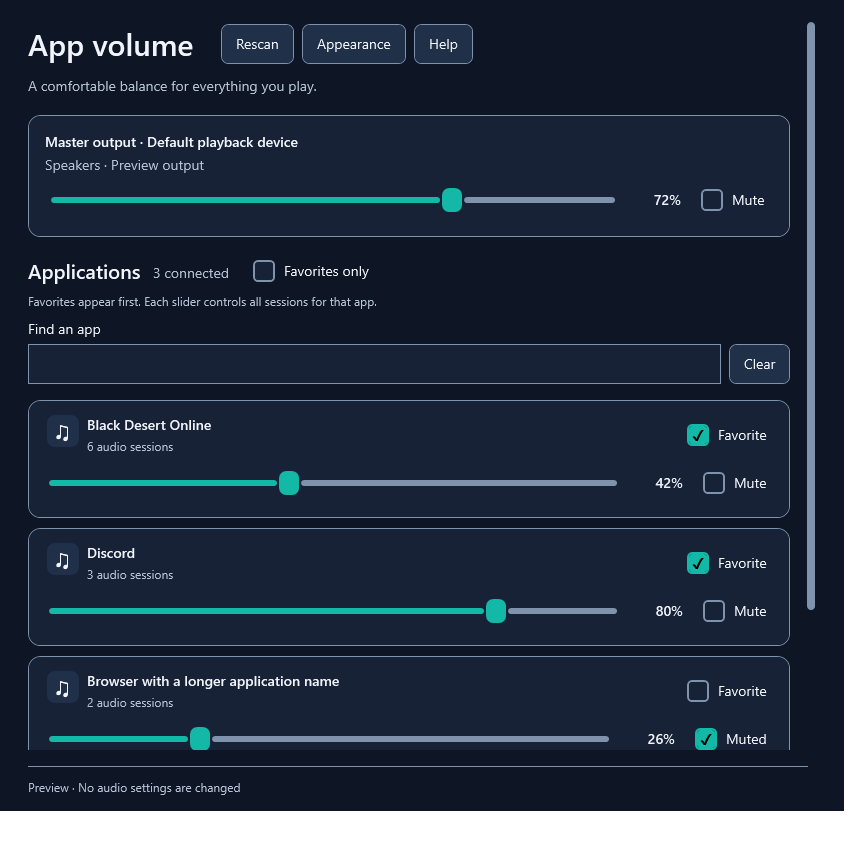
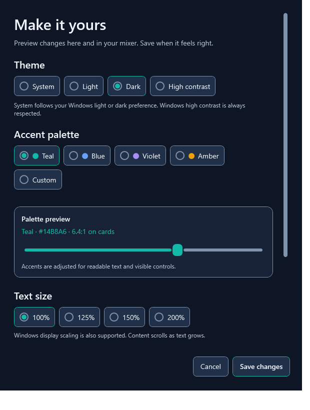

<p align="center"></p>

# App Volume Controller

A native Windows volume mixer for balancing games, voice chat, browsers, and other apps. Set per-app volume and mute, keep favorites close, and choose a readable theme that suits you.

**[Download the public beta](https://github.com/XayerMorgan/AppVolumeController/releases/tag/v0.1.0-beta.2)** · **[User guide](docs/USER-GUIDE.md)** · **[Report a problem](https://github.com/XayerMorgan/AppVolumeController/issues/new/choose)**



## Install and start

1. Open [Releases](https://github.com/XayerMorgan/AppVolumeController/releases) and download **AppVolumeController-0.1.0-beta.2-win-x64-Setup.exe**.
2. Run it and follow the installer. A desktop shortcut is optional.
3. Open **App Volume Controller** from the Start menu.
4. Play some audio in an app, then adjust its slider. Apps appear automatically; **Rescan** checks immediately.

Requires **Windows 10 22H2 (build 19045) or Windows 11**, with an x64-compatible PC and a playback device. Intel/AMD x64 is tested; Windows on ARM is unverified. The installer includes .NET and installs for your account without administrator access. No login is required.

**Unsigned beta:** Windows may display an unknown-publisher or SmartScreen warning. Download only from the official release page and decide whether you trust the release before running it. SHA-256 checksums are included; they are not a digital signature.

Prefer no installer? Download **Portable.zip**, extract the entire archive, and run `AppVolumeController.exe`. Keep the files together. GitHub's **Source code** ZIP/TAR archives are for developers and do not contain a ready-to-run app.

## What it does

- Adjust volume and mute for each application, including grouped sessions across active playback devices.
- Find apps with search, mark favorites, and filter to favorites only.
- Control the Windows default multimedia playback device through Master output.
- Optionally restore volume/mute changes when apps create new audio sessions.
- Choose system, light, dark, or high contrast themes, preset/custom accents, and text sizes up to 200%.
- Navigate with the keyboard using visible focus and application-specific screen-reader labels.

There is no background service, startup task, telemetry, or automatic updater. Preferences stay on your PC. Microphones and exclusive-mode audio are outside the app's scope.



Screenshots use sample applications and values, not a user's live audio sessions.

## Help and support

Choose **Help** or press **F1** in the mixer to open the included offline `HELP.html` in your browser. The Start menu also contains a **User help** shortcut.

- [User guide and troubleshooting](docs/USER-GUIDE.md)
- [Testing checklist](docs/TESTING.txt)
- [Release history](CHANGELOG.md)
- [Bug reports and feature requests](https://github.com/XayerMorgan/AppVolumeController/issues/new/choose)

When reporting a problem, include the app version, Windows version, installation type, affected application/output device, and steps to reproduce. Do not share passwords, private audio, or your complete preferences file.

## Updates and uninstall

Close the app, then run a newer installer from Releases. Preferences are retained. Remove the app through **Windows Settings → Apps → Installed apps** (Apps & features on Windows 10). Uninstall leaves preferences at `%LOCALAPPDATA%\AppVolumeController\preferences.json` for a later reinstall. Installed and portable copies use the same settings location.

## Build from source

On Windows with the [.NET 10 SDK](https://dotnet.microsoft.com/download/dotnet/10.0):

```powershell
git clone https://github.com/XayerMorgan/AppVolumeController.git
cd AppVolumeController
.\Build.ps1
.\Run.cmd
```

The script publishes a self-contained app to `artifacts/publish/win-x64`. If PowerShell blocks a script, use a one-time process invocation from a source checkout you trust: `powershell -NoProfile -ExecutionPolicy Bypass -File .\Build.ps1`. No machine-wide execution-policy change is needed.

See [development and release instructions](docs/DEVELOPMENT.md) for verification, installer creation, and the project layout. [Contribution guidelines](CONTRIBUTING.md) cover focused pull requests and accessibility expectations.

## Verification and limits

Local checks cover palette contrast, preferences, UI Automation labels, keyboard navigation, search, large-text layouts, audio controls on a silent test session, and installer install/reinstall/uninstall behavior. GitHub Actions builds on Windows and checks palettes and preference compatibility without requiring audio hardware.

Hands-on Narrator/NVDA use, physical device unplug/replug, multi-monitor DPI transitions, and wider hardware coverage still need testing. This is a beta, not a claim of complete accessibility conformance.

## License

[MIT](LICENSE), copyright 2026 XayerMorgan and contributors. NAudio and bundled .NET runtime notices are included with distributed builds in `licenses/`.
